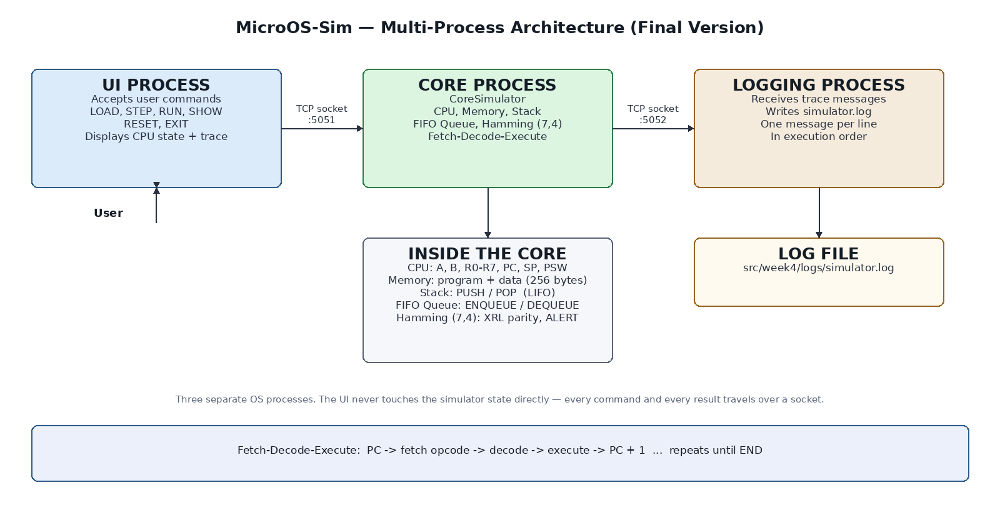

# MicroOS-Sim — Multi-Process Microcontroller Simulator

**Educational simulator for the STC89C52 8-bit microcontroller (8051-compatible), written in Java.**

> ✅ **Project status: Completed.** Built over five weekly sprints as a Project-Based Learning (PBL) project. All test cases pass — instruction execution, stack and queue behaviour, IPC message delivery, and both Hamming error-detection scenarios.

MicroOS-Sim makes the invisible visible: after every instruction you can see the program counter advance, registers change value, and the stack grow and shrink — while several programs are managed on one processor. The simulator is organised as three separate processes (UI, Core and Logging) connected by Java TCP socket IPC, and it demonstrates Hamming (7,4) single-bit error detection with on-demand code generation.

---

## About the Project

Students learning the 8051-family microcontroller must understand how the CPU fetches, decodes and executes instructions, how memory and the stack work, and how several programs can share one processor. Real hardware gives no visibility into registers, the program counter or the stack. MicroOS-Sim fills that gap with a software simulator that shows the internal state of the microcontroller after every instruction, supports step-by-step execution, and demonstrates process management and error-detection coding in the same working system.

**This project combines:**

- Microprocessor Architecture
- Data Structures
- Operating Systems
- Inter-Process Communication

---

## Features

- **STC89C52 CPU model** — 8-bit accumulator (A) and B register, program counter (PC), flags (PSW), stack pointer (SP), DPTR, register banks R0–R7, and 256 bytes of internal RAM.
- **Fetch–Decode–Execute cycle** — a 15-instruction 8051-style set: `MOV`, `ADD`, `SUBB`, `INC`, `DEC`, `ANL`, `ORL`, `XCH`, `CLR`, `SJMP`, `XRL`, `ALERT` and more.
- **Memory, stack and queue** — memory read/write, stack `PUSH`/`POP`, and FIFO queue `ENQUEUE`/`DEQUEUE`.
- **Step-by-step execution** — `LOAD`, `STEP`, `RUN`, `RESET`, `SHOW` commands with a live execution trace and full CPU state after every instruction.
- **Multi-process architecture** — the UI, Core and Logging components run as separate processes connected by Java TCP sockets (see Architecture below). The original POSIX FIFO design was replaced because named pipes are not supported on Windows.
- **Hamming (7,4) error detection** — even-parity codeword generation, syndrome calculation, and single-bit error detection with an alert dialog.
- **GENERATE CODE** — the UI's Hamming panel generates real assembly for any data bits you enter and loads it into the editor.
- **Session logging** — every session writes a timestamped log (`MicroOS_Log_YYYY-MM-DD_HH-MM-SS-mmm.txt` in `src/week4/logs/`) recording commands, responses, CPU state, memory snapshots, stack/queue changes, Hamming calculations and process events.
- **Graphical interface** — a Swing UI with an editor, execution trace, CPU state panel, Hamming panel and a theme toggle.

---

## Architecture

Three processes, connected by Java TCP sockets over localhost:

| Process | Role | Listens on |
|---|---|---|
| **UI** (`src/week4/ui/UIProcess.java`) | Graphical interface, editor, trace display, Hamming panel | — (connects to Core) |
| **Core** (`src/week4/core/CoreProcess.java`) | CPU, memory, stack, queue, instruction execution, Hamming calculation | `127.0.0.1:5051` |
| **Logging** (`src/week4/logging/LoggingProcess.java`) | Records trace and log messages to timestamped session files | `127.0.0.1:5052` |

The UI sends commands to the Core over its socket and receives the resulting state and trace back; the Core forwards log messages to the Logging process. The UI never calls CPU, Memory, Stack, Queue, Simulator or Logger classes directly.



---

## Project Structure

```text
MicroOS-Sim/
├── README.md                     # This file
├── src/                          # Weeks 1–3: CPU, memory, stack, queue, simulator
│   ├── CPU.java  Memory.java  Stack.java  Queue.java
│   ├── Instruction.java  InstructionSet.java  Simulator.java  Main.java
│   └── week4/
│       ├── core/                 # Core process: CPU, memory, stack, queue, FDE
│       ├── hamming/              # HammingCode.java + demo programs
│       ├── ipc/                  # Socket configuration and helpers
│       ├── logging/              # Logging process
│       ├── ui/                   # UI process (Swing)
│       ├── integration/          # Launcher and smoke tests
│       └── logs/                 # Timestamped session logs
├── tests/                        # Tests (instruction, memory, stack,
│   │                             # queue, demo program, Hamming)
├── programs/                     # Demo assembly programs
├── images/                       # Architecture diagram and UI screenshots
└── Docs/                         # Meeting minutes, decision logs, weekly status
    ├── Meeting/  decisions/  weekly-status/
```

Other README files in the repo document individual parts: `src/week4/ui/README.md` (build and run), `src/week4/core/README.md`, `src/week4/hamming/README.md`, `src/week4/logging/README.md`, and the week-wise `WEEK-2 README.md`, `WEEK-3 README.md`, `4weekREADME.md`, `Hamming_README.md`.

---

## Getting Started

### Requirements

- **Java** (JDK 17 or newer)
- **Windows** (the multi-process version uses Java TCP sockets; it runs on localhost)

### Build and Run (Week 4 multi-process version)

Open PowerShell in the repository root and compile:

```powershell
javac -d out src\*.java src\week4\ipc\*.java src\week4\core\*.java src\week4\logging\*.java src\week4\hamming\*.java src\week4\ui\*.java
```

Then run each process in a **separate terminal, in this order**:

```powershell
java -cp out week4.logging.LoggingProcess
```

```powershell
java -cp out week4.core.CoreProcess
```

```powershell
java -cp out week4.ui.UIProcess
```

Core listens on `127.0.0.1:5051` for the UI; Logging listens on `127.0.0.1:5052` for messages from Core. Allow Java through Windows Firewall for local loopback if prompted.

In the UI you can `LOAD` a program, `STEP` through it instruction by instruction, `RUN` it to completion, `RESET` the CPU, or `SHOW` the current state.

---

## Hamming (7,4) Error Detection

The Week 4 UI has a **HAMMING CODE** panel: choose a data-bit size (4, 5, 8, 11 or 12 bits), enter binary data, pick an error position if you want to inject one, and click **GENERATE CODE**. The UI sends `HAMMING|data-bit-count|data-bits|errorPos` to the Core; `HammingCode.generateAssembly()` generates the assembly and returns it, and the UI places it in the editor.

Demo programs included in `src/week4/hamming/`:

| Program | What it shows |
|---|---|
| `Hamming74Demo.asm` | Error injected at bit position 3 — the `ALERT` reports **error at bit 3 (syndrome 011)** |
| `Hamming74NoError.asm` | Clean codeword — the `ALERT` reports **no error detected (syndrome 000)** |

### Verified Results

| Test | Result |
|---|---|
| Queue (FIFO) | R0 = 10, R1 = 20, R2 = 30, then queue EMPTY |
| Stack (LIFO) | R0 = 20, R1 = 10 |
| Normal program | A = 07 |
| Hamming, error injected | Syndrome 011 — error at bit position 3 |
| Hamming, no error | Syndrome 000 — no error detected |
| Hamming demo program end | A = 1E, PC = 0009 |

Every test case passed, including instruction execution, stack and queue behaviour, IPC message delivery and both Hamming scenarios. Test sources are in `tests/` (`DemoProgramTest`, `HammingCodeTest`, `InstructionTest`, `MemoryTest`, `QueueTest`, `StackTest`).

---

## Development Timeline

| Week | What was built |
|---|---|
| 1 | Team formation, repository setup, STC89C52 architecture study, language selection (Java), basic design |
| 2 | CPU model — registers, program counter, flags, ALU, memory; instruction execution begins |
| 3 | Memory, stack (PUSH/POP) and FIFO queue (ENQUEUE/DEQUEUE) operations |
| 4 | Multi-process design — UI, Core and Logging processes over Java TCP socket IPC (replacing POSIX FIFO, which Windows does not support) |
| 5 | Hamming (7,4) error detection — parity generation, syndrome calculation, GENERATE CODE, detailed session logging |

Work was organised with GitHub branches, pull requests, meeting minutes and decision logs — all in this repository under `Docs/`.

---

## Team

| Member | Reg. No. | Role | Share |
|---|---|---|---|
| **MUHAMMED HISHAM M H** (Team Leader) | 25190130 | STC89C52 CPU / Architecture, GitHub & Project Integration | 25% |
| **ABDUL RAHMAN IZHAN** | 25190102 | Core Process & FDE, OS Scheduling & Simulator Planning, UI Design | 25% |
| **PUNARVI J** | 25190156 | UI Process & Visuals, Memory & Stack Study, Architecture Diagram | 25% |
| **KEORA PAIS** | 25190118 | Logger & Telemetry, Data Structures & Process Management, Testing Plan | 25% |

**Mentor:** Mr Vijay Ganesh

<table>
<tr><td align="center">
<br>
<b>Izhan</b>
</td><td align="center">
<br>
<b>Keora</b>
</td><td align="center">
<br>
<b>Punarvi</b>
</td><td align="center">
<br>
<b>Hisham</b>
</td></tr>
</table>

---

## Future Work

- **CPU scheduling layer** — process control blocks (PCB), a ready queue, context switching, and FCFS, Round Robin and Priority scheduling, with performance metrics (waiting time, turnaround time, response time, CPU utilisation).
- **GPIO, timer and interrupt simulation** for the STC89C52 peripherals.
- **Automatic Hamming error correction** in addition to detection.
- **Richer graphical interface** — deeper visualisation of CPU state, memory and the ready queue.
- **Quantitative IPC benchmarking** — measuring socket latency and message throughput between the three processes.

---

## Documentation

- The full PBL report — *Multi-Process Microcontroller Simulator: Design, Implementation & Evaluation* (17 pages, with architecture, simulation examples, screenshots and the state-change tables) — documents the finished project.
- `Docs/Meeting/` — meeting minutes for all five weeks.
- `Docs/decisions/` — decision logs (including the POSIX FIFO → TCP socket switch).
- `Docs/weekly-status/` — weekly status notes.

## References

- Department of Computer Science & Engineering, "PBL Simulator Evaluation Rubrics & Task Sheets," St. Joseph Engineering College / St. Aloysius University, 2026.
- P. C. Vijay Ganesh, "8051 Microcontroller Web-based Simulator for Academic Instruction," GitHub Repository & Academic Tools, 2021.
- D. A. Patterson and J. L. Hennessy, *Computer Organization and Design: The Hardware/Software Interface*, 5th ed., Morgan Kaufmann, 2014.
